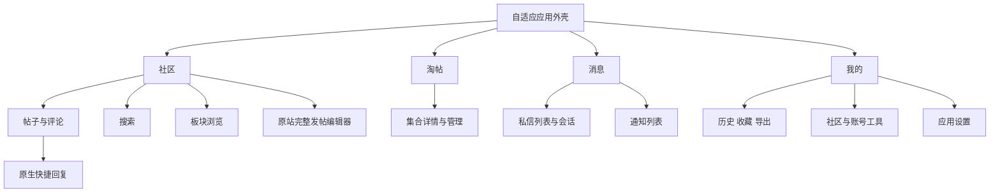

# LinuxSB · MD3 全面界面重设计开发方案

版本：2.0 / 2026-10-21  
状态：**待实施的设计与开发合同；不是已完成的界面，也不是新设计的验收报告。**  
技术范围：Android、Kotlin、Jetpack Compose Material3；覆盖原生界面和原站页面的应用外壳。  
本轮交付：仅 Markdown 文档。未修改业务代码、主题实现、依赖或设备设置。

后续实现复验（2026-10-21）：见 [MD3 大改版实现验收记录](md3-redesign/ACCEPTANCE_REPORT.md) 第 6 节。应用构建通过，上轮六项未关闭，另新增一项 P2；模拟器已复现详情丢失与宽屏钉住崩溃。物理真机及登录流程仍未验证；本文下面仍为设计合同，不以已有代码自动改写验收标准。

## 1. 阅读顺序与规则来源

| 文档 | 负责回答的问题 |
| --- | --- |
| 本文 | 产品方向、全局设计决策、信息架构、跨页面规则和交付边界 |
| [设计系统与组件规范](md3-redesign/DESIGN_SYSTEM.md) | 具体颜色、字号、间距、尺寸、形状、组件契约、状态与无障碍 |
| [页面设计规格](md3-redesign/SCREEN_SPECIFICATIONS.md) | 每个页面家族怎样排版，主次操作放在哪里，现有路由如何覆盖 |
| [实现与验收计划](md3-redesign/IMPLEMENTATION_AND_ACCEPTANCE.md) | 改哪些现有边界、迁移哪些偏好、按什么顺序开发、如何判定完成 |

依据已读取的 [material-3 技能](C:/Users/ushio/.codex/skills/material-3/SKILL.md) 与 Android 官方资料制定。本机技能路径仅用于说明本轮依据；跨机器实施不依赖该路径存在。平台依据在相关条款旁附官方链接。

文档中的三类约定需要区分：

- **平台/MD3 约束**：语义颜色角色、系统字号、可访问触区、系统安全区等，有对应官方依据。
- **本方案设计定值**：例如蓝色种子、18/30sp 阅读正文、四个默认主目的地，是本项目的设计选择。
- **实施时核实项**：实际依赖版本、实验 API 和业务状态可用性，必须以工程证据确定。

本方案替代 [旧 UI 开发规范](UI_DEVELOPMENT_GUIDE.md) 中“保持迁移前外观”的视觉基线；旧文档的职责分层、公共实现、最小依赖和 250 行源码上限继续适用。若文档存在重叠，视觉值以 DESIGN_SYSTEM 为唯一来源，页面特有行为以 SCREEN_SPECIFICATIONS 为准，实现与数据契约仍遵从当前业务规则。不能以旧截图阻止本次明确授权的视觉变化。

## 2. 设计目标

将 LinuxSB 设计为适合长时间阅读、快速浏览和轻量交流的社区客户端。默认界面采用低装饰的色调表面、明确的内容层级、稳定的导航和克制的动态反馈。

完成后的可观察结果：

1. 社区、淘帖、消息、我的具有统一的导航语言；根页面、详情、编辑和源站页面的外壳职责清晰。
2. 列表优先呈现标题与来源，正文优先呈现内容；主题色集中用于选中、焦点与主要操作。
3. 共享组件改变一次，其全部消费页面同步变化；页面不再复制开关行、错误块、标题栏或菜单样式。
4. 窄窗口可顺序阅读，宽窗口可并列浏览；切换窗口时保留当前内容与草稿。
5. 动态色、浅深色、用户字体和已有阅读偏好继续可用，升级时不重置账号、本地内容或网络配置。
6. 每项页面和关键状态有明确验收样本；尚未执行的检查保持“待执行”。

## 3. 已确定的视觉方向

| 方面 | 新设计决策 | 开发含义 |
| --- | --- | --- |
| 色彩 | 默认品牌回退为蓝色 TonalSpot，支持系统动态色 | 使用完整浅/深 ColorScheme；不是只换 primary |
| 表面 | surface 为阅读底，container 层级分组 | 普通列表无逐项厚重阴影；浮层通过色调与遮罩区分 |
| 导航 | 标准 NavigationBar / NavigationRail | 移除默认玻璃、透镜、色散与悬浮胶囊底栏表现 |
| 列表 | 单列、对齐明确的 TopicListItem | 标题与元信息分行；普通条目平面展示，选中项有 tonal 背景 |
| 阅读 | 正文 18sp / 30sp；阅读列最大 720dp | 正文样式独立于设置页 bodyLarge；完整标题留在正文顶部 |
| 形状 | 小范围层级化圆角 | 列表平面、卡片 12dp、面板 16dp、模态 28dp、按钮 full |
| 字体 | 系统字体及中文 fallback，默认正常字重 | 保留自定义字体；避免整个界面一律加粗 |
| 图标 | 24dp，清楚的轮廓/填充选中差异 | 触区至少 48dp；图标不替代必要文本标签 |
| 动效 | 状态变化轻快、内容位置稳定 | 页面切换统一；减少动画时去除大位移与装饰循环 |
| 特殊身份 | 用户称号、楼主、板块、未读各有不同语义 | 保留源站称号信息，限制同时展示的视觉权重 |
| 背景定制 | 保留可选背景，内容区域有阅读保护面 | 不把整个 ColorScheme 统一改为透明 |

这些决策允许明显改变现有样式。现有玻璃效果不进入新设计默认样式，也不要求维护第二套与新设计并行的视觉系统。旧偏好键保留，迁移映射和回退方式见实现计划。

## 4. 信息架构与入口

### 4.1 默认主导航

| 主目的地 | 稳定身份 | 内部内容 | 导航图标概念 |
| --- | --- | --- | --- |
| 社区 | 沿用 `home` | 首页信息流、板块入口、内容分类、搜索入口 | Home |
| 淘帖 | 淘帖现有 canonical 目的地 | 大家/我的/订阅等现有视图及集合详情 | CollectionsBookmark / ViewList |
| 消息 | 私信目的地的兼容映射 | 私信、通知两个分区 | Chat / Forum |
| 我的 | 沿用 `me` | 身份、本地内容、社区工具、应用设置 | Person |

“消息”只是把已有私信和通知组织在同一导航位置，不新增消息服务、离线消息库或未读计数协议。没有可靠总未读数时不伪造合计数字；可显示服务已有的分区未读点。

发帖为 **动作**。社区列表展示“发帖”FAB，详情和编辑页不显示此 FAB；宽屏可将同一个动作置于 rail 上方。游客点击后进入现有登录门禁，成功回到发帖目标。不能让“发帖”变成始终选中的第五个根页面。

底部标签保持图标和文字。默认四项；保留用户对目的地顺序/显隐的布局偏好能力。3—5 个有效根目的地采用 bar/rail；只有两项的旧自定义使用顶部 PrimaryTabRow，根内分区改用分段控件，避免两条同形 TabRow 相叠；不足两项时派生默认四项并说明如何重新配置，不写回覆盖原值。别名、发帖动作及未知值的详细迁移见实现计划。禁止通过新默认值覆盖已经保存的自定义顺序。

### 4.2 可发现性与命名

- 社区顶栏提供搜索和板块入口；最新回复、最新主题、精华是排序视图，抽奖/发卡/红包/申精等独立源站列表通过内容类型入口访问。
- 搜索与筛选只表达服务支持的组合；不能把不同数据源画成任意可组合的筛选器。
- 我的保留个人资料与账号、我的内容、社区工具、应用设置入口。`settings` 当前是原站“个人资料与账号”，`appSettings` 才是应用设置；不因路由旧名误接页面。
- 应用设置按“阅读与交互、外观与布局、发帖与图片上传、网络与链接、AI 助手、存储与备份、应用与账号”组织。源站账号设置从应用配置中明确区分。
- 自动签到继续由原流程负责，不新增签到按钮、独立入口或签到 FAB。只允许展示业务已提供的结果。

## 5. 窗口与页面外壳

### 5.1 规则

使用当前应用窗口尺寸分类，不能仅依据设备型号或用户的“平板模式”开关。Android 的宽度断点为 600、840、1200、1600dp；小高度阈值为 480dp。[官方窗口分级](https://developer.android.com/develop/ui/compose/layouts/adaptive/use-window-size-classes)

| 条件 | 主导航 | 内容形态 |
| --- | --- | --- |
| 宽度 <600dp | 根页面底部导航 | 单栏，列表与详情顺序导航 |
| 高度 <480dp 的根页面 | 优先底部导航，详情/编辑不显示根导航 | 单栏；键盘弹出不触发导航树重建 |
| 宽度 ≥600dp 且高度足够 | 80dp 导航 rail | 是否双栏继续按内容可用宽度判断 |
| Expanded / Large / Extra-large | 继续复用相同 rail 目的地 | 满足最小宽度时使用列表—详情；阅读列仍限宽 |

四个主目的地不需要在 840dp 强制转换为常驻 drawer。导航形式是产品选择，窗口宽度和实际内容预算共同决定布局。[官方自适应导航](https://developer.android.com/develop/ui/compose/layouts/adaptive/build-adaptive-navigation)

上表适用于默认和有效目的地为 3—5 项的布局；两项兼容布局按 §4.1 使用根级顶部 Tab，U 中导航占用宽度为 0，但要计入其高度。

双栏预算使用 `U = 窗口宽度 − 左右安全区 − 实际导航宽度 − 两侧页面边距`。默认列表最小 280dp，栏间距 24dp，正文最小 400dp，因此 `U ≥ 704dp` 才具备双栏资格；这些最小值是本项目定值。实际分配时列表目标 320dp、最大 360dp，详情取余量并限制阅读列最大 720dp。

用户选择“始终单内容栏”时尊重该偏好。旧 tablet_mode 的缺失、true、false 分别如何映射见实现计划；主导航仍按窗口适配。

大字号、折叠姿态或实际文字测量使上述宽度不够时回退单栏，不通过缩小字体、触区或按钮解决。600–839dp 通常仍是单内容栏。折痕两侧分别测量可用区域，交互内容不跨铰链。

### 5.2 外壳职责

| 层级 | 拥有的内容 | 不拥有的内容 |
| --- | --- | --- |
| 应用外壳 | 根导航、窗口策略、pane 宿主、全局 SnackbarHost | 页面请求、表单保存、帖子操作协议 |
| 普通页面外壳 | 64dp 顶栏、返回图标、actions、正文 padding | 登录判断与 repository 调用 |
| 阅读模式 | 可滚动完整标题、正文、评论、底部回复动作区 | 独立的第二套主题与错误 UI |
| 编辑/会话模式 | 输入区、IME 避让、草稿离开保护的呈现 | 自动提交、离线发送队列 |
| 原站模式 | 可信来源标识、真实 URL 外部打开、加载/错误、现有平台桥接 | 改写源站 DOM、CSRF、验证码检测或奖励协议 |

所有外壳复用同一 theme 和基础组件。真实结构差异通过有职责的 pattern 表达，不把所有页面塞入带大量布尔参数的通用外壳。

## 6. 全局交互合同

### 6.1 返回与状态恢复

处理顺序为：有焦点的输入法 → 当前浮层/搜索/预览 → 当前详情 → 所属根目的地 → 当前产品的根级退出行为。实现时由实际活跃宿主处理事件，避免多个 BackHandler 同时弹栈。

`onBack=null` 只代表不显示顶栏返回图标，不能解释为禁用系统返回。双栏中返回应先撤销详情内层级，再回到列表焦点；不得直接退出应用。

根目的地、列表筛选、分页位置、选中 ID、正文锚点、草稿和当前消息分区的逻辑状态独立于布局形态。旋转、分屏、折叠和浅深色切换不会重新发起提交或静默丢弃输入。大屏去掉一栏时，应显示用户当前正在操作的内容。

### 6.2 加载、错误与操作反馈

首次加载、保留旧内容的刷新、加载下一页、首次失败、已有内容上的失败、空结果、未登录、无权限和提交中具有不同呈现。只刷新局部内容时不移除已读列表。重试在失败区域就近出现。

成功提示优先短 Snackbar；必须长期处理的错误使用页内 Notice。提交中保留按钮文字与忙碌语义，禁止重复提交；失败保留输入。用户离开某页后到达的失败不得在另一页面显示误导性的全屏错误。

### 6.3 读、写与源站能力

- 公开内容对游客可读，应用设置和本地内容不整体套登录门禁。
- 依赖登录/权限的操作在真实边界提示，成功后回到原目标。权限和费用来自源站，不由 UI 推测。
- 收费搜索的费用说明、确认与分页授权继续保留；新搜索布局不能引入重复扣费触发器。
- 发帖/编辑主题仍使用完整原站编辑器，原生快捷回复继续支持预览、附件和验证码；两种编辑器共享外壳语言，不混称业务实现。
- WebView 内部视觉属于源站；只统一应用外壳与桥接反馈。本地导出 HTML 和联网网页的执行权限继续区分。

## 7. 这次开发应产生的交付物

1. DESIGN_SYSTEM 中 token 与公共组件的实际实现及隔离预览；正常、长文本、禁用与错误状态可查看。
2. 页面规格中全部家族及现有路由的改版，不以只完成四个根页面代替。
3. 旧偏好到新设计的迁移映射，覆盖自定义底栏、玻璃样式、平板模式、角色色、字体和背景配置。
4. 单栏/双栏共用同一业务状态和事件路径，保留原站、网络、发布与存储契约。
5. 按实现计划完成的构建证据、最终真机回归记录和明确残余项。

优先顺序为：设计系统与预览 → 应用壳和导航 → 社区/阅读 → 消息/回复 → 我的/设置 → 工具与原站外壳 → 完整回归。不要同时更换解析协议、账号体系或网络栈。

## 8. 完成定义与当前状态

“设计文档完成”要求：所有已有路由有归属，关键尺寸/颜色/状态有确定来源，偏好迁移可执行，边界和验收方法可辨认。这是本轮交付。

“新 UI 完成”要求：后续实现满足各文档约定，并取得相应构建和验收证据。旧 [UI 验收报告](UI_ACCEPTANCE_REPORT.md) 只证明上一版结构重构的检查结果，不证明本方案已经实现。

本轮不创建发布承诺、不修改忽略规则。`docs/` 当前被 Git 忽略；文档在本地工作区可用，若需进入版本管理，由开发时按项目安排显式纳入。
